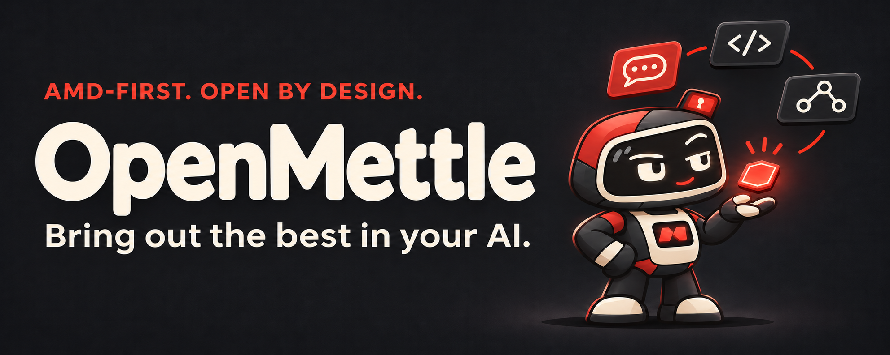

# OpenMettle community

Shared project information and GitHub defaults for OpenMettle.

| Resource | Purpose |
| --- | --- |
| [Organization profile](profile/README.md) | Public introduction and project status |
| [Brand assets and guide](assets/brand/README.md) | Mettle avatar, banners, mockups and the full design archive |
| [Project brief](docs/PROJECT-BRIEF.md) | Scope, principles and initial milestones |
| [Contribution guide](CONTRIBUTING.md) | How to report issues and propose changes |
| [Code of conduct](CODE_OF_CONDUCT.md) | Expectations for participation |
| [Security policy](SECURITY.md) | Private vulnerability reporting |
| [Support](SUPPORT.md) | Questions, troubleshooting and expectations |
| [Bootstrap checklist](docs/BOOTSTRAP.md) | Owner setup and repository conventions |
| [Porting checklist](docs/PORTING.md) | Generalizing an existing implementation |
| [Repository template](https://github.com/OpenMettle/repository-template) | Starting point for a new component |

GitHub uses the supported community files here as defaults when an organization repository does not provide its own. Issue forms live in `.github/ISSUE_TEMPLATE`; the PR template lives at the root. These defaults are not copied into repository clones.

**Workflows, scripts, CODEOWNERS and licenses are not automatically inherited.** Create new components from the repository template to get the workflow and repository checks. The optional workflow template in `workflow-templates/` also requires copying `scripts/check_repository.py` into the target repository first.

This repository and the original starter material use the [MIT License](LICENSE). Every component must include its own applicable license.

The brand collection preserves the original generated PNG files in Git, with dimensions and checksums in its [manifest](assets/brand/manifest.json). See the [brand guide](assets/brand/README.md) for current assets and the separate concept archive.

Run the local checks with `python3 scripts/check_repository.py`.
