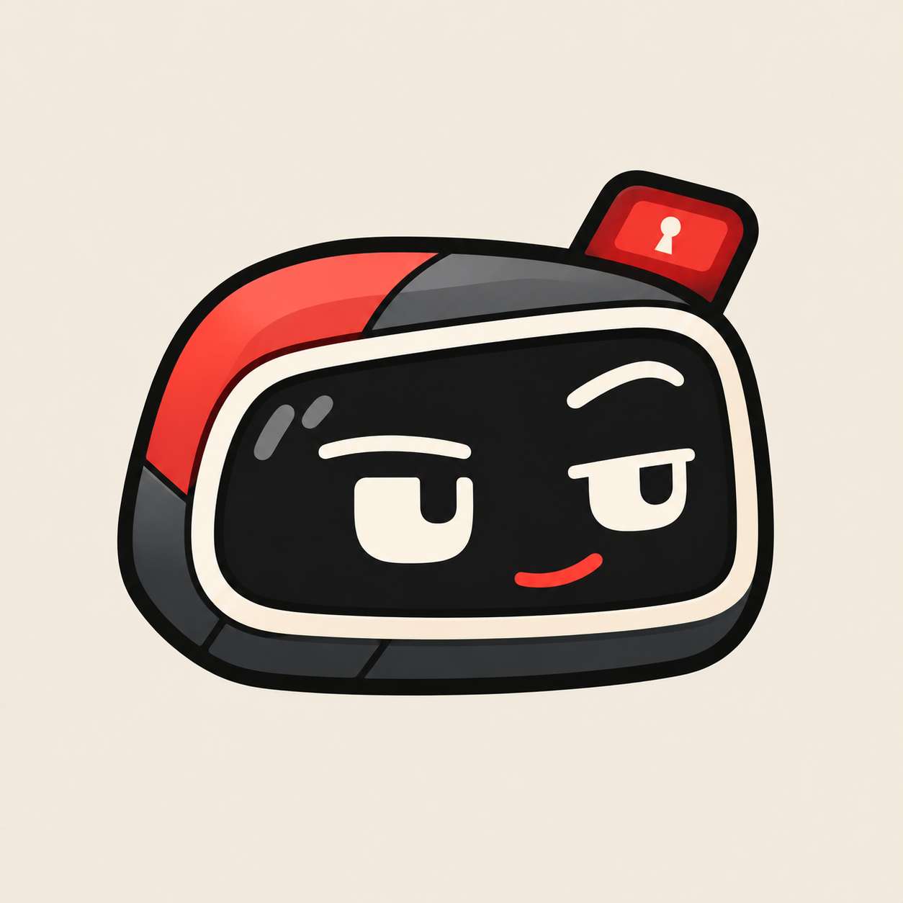
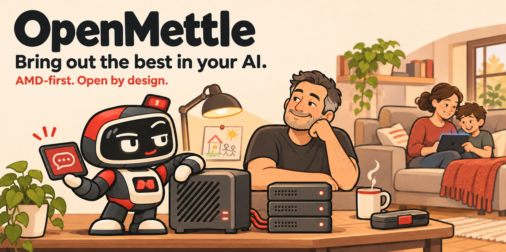
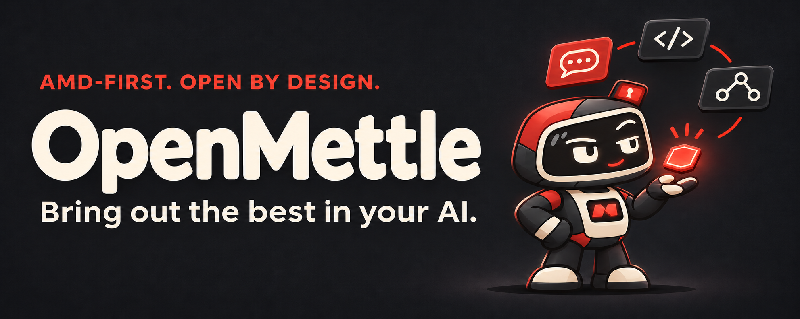
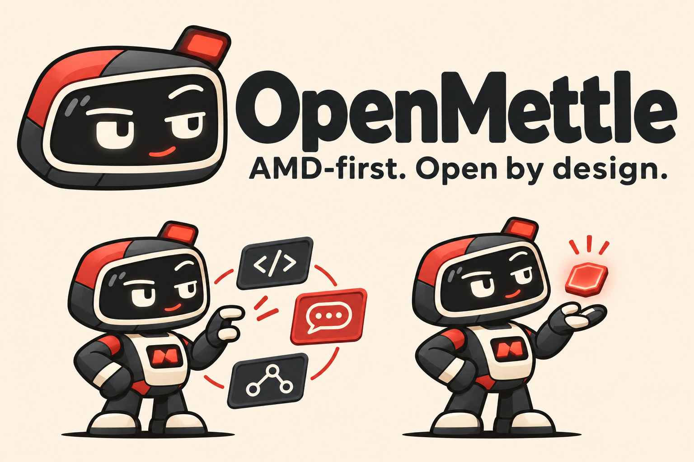
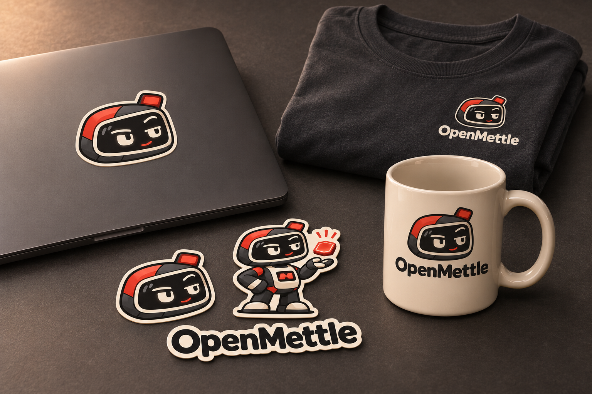

# OpenMettle brand assets

The home of Mettle and the OpenMettle visual identity. All 15 original PNG files from the design session are preserved here in Git. The [manifest](manifest.json) records dimensions, byte counts and checksums.



## Current assets

| File | Intended use |
| --- | --- |
| [openmettle-avatar-transparent.png](current/openmettle-avatar-transparent.png) | Transparent organisation avatar; 690 KB, below GitHub's 1 MB upload limit |
| [openmettle-avatar.png](current/openmettle-avatar.png) | Original head mark on ivory; high-resolution reference |
| [openmettle-homelab-hero.png](current/openmettle-homelab-hero.png) | Warm home-lab and family introduction; organisation profile hero |
| [openmettle-banner-dark.png](current/openmettle-banner-dark.png) | Dark README, project and presentation banner |





## Identity

**Name:** OpenMettle. **Character:** Mettle.

**Main line:** Bring out the best in your AI.

**Positioning:** AMD-first. Open by design.

Mettle is capable, approachable and slightly cheeky: the digital sidekick of someone who enjoys making a home lab useful for the whole household. The tone is warm and technically credible, with understated humour.

Keep the wide, squat robot head; graphite display; ivory eyes and face rim; single raised eyebrow; small red smile; and offset red status tab. The keyhole in that tab is a small privacy cue. Full-body artwork adds the compact body, ivory chest panel and red compute-tile core. Preserve the expression and silhouette when making new poses.

Privacy is represented by that small detail and by thoughtful product choices. Copy should describe control over data and connections, and distinguish design goals from tested behaviour.

## Palette

These are design targets; shading and texture in raster artwork vary.

| Colour | Hex | Role |
| --- | --- | --- |
| Graphite | `#24272C` | Shell, outlines and dark typography |
| Deep charcoal | `#191C21` | Dark banner backgrounds |
| Warm ivory | `#F2EBDD` | Light backgrounds, face rim and eyes |
| Vermilion | `#E7473C` | Hardware accents, status tab and emphasis |

The wordmark is illustrated lettering in the supplied images. No editable font source or exact font family is asserted. Use a sturdy humanist sans for accompanying text and keep the spelling **OpenMettle**.

## Using the files

- Use the files under `current/` for the organisation identity. Keep proportions and clear space; include the whole status tab in avatar crops.
- For another repository, link to the raw file here or intentionally copy a specific version. Pin a commit in a raw URL when the consuming project needs an immutable reference.
- Keep text equivalents and useful image descriptions alongside banners for accessibility.
- Preserve originals when exporting smaller web files or production artwork. Add a descriptively named sibling and record its provenance.
- Keep new proposals in `mockups/` until selected. Move superseded assets into `archive/` and update references when replacing a current asset.

The source files are generated raster PNGs. Vector masters and print-production files have not been created. Merchandise images are illustrative mockups. See the repository [license](../../LICENSE).

## Mockups

These studies precede the small keyhole refinement; use the current avatar as the reference for that detail in future production work.

| File | Study |
| --- | --- |
| [robot-red-identity-sheet.png](mockups/robot-red-identity-sheet.png) | Logo and full-body poses in graphite, ivory and red |
| [merchandise.png](mockups/merchandise.png) | Sticker, laptop, mug and T-shirt presentation |

<details>
<summary>View the mockups</summary>





</details>

## Earlier concepts

Every earlier image is retained for reference. These are design history, not the current identity.

| File | Stage |
| --- | --- |
| [01-geometric-wordmark.png](archive/01-geometric-wordmark.png) | Initial transparent geometric logo |
| [02-geometric-avatar.png](archive/02-geometric-avatar.png) | Initial geometric avatar |
| [03-geometric-banner.png](archive/03-geometric-banner.png) | Initial geometric banner |
| [04-badger-workshop.png](archive/04-badger-workshop.png) | Workshop badger |
| [05-badger-ai.png](archive/05-badger-ai.png) | Digital badger |
| [06-robot-teal.png](archive/06-robot-teal.png) | First robot identity |
| [07-robot-red-banner.png](archive/07-robot-red-banner.png) | Red robot banner before privacy detail |
| [08-homelab-family.png](archive/08-homelab-family.png) | Home-lab hero before privacy detail |
| [09-robot-red-avatar.png](archive/09-robot-red-avatar.png) | Standalone head before privacy detail |

## Owner settings

The profile README and repository artwork are versioned here. GitHub's organisation avatar is a separate owner setting: use `current/openmettle-avatar-transparent.png` for that image. Suggested organisation description: **AMD-first open-source AI for home labs and households, with privacy and practical usability in mind.**

## Verify the archive

From the repository root, verify the original asset bytes against the manifest:

```sh
python3 - <<'PY'
from pathlib import Path
import hashlib, json
root = Path('assets/brand')
manifest = json.loads((root / 'manifest.json').read_text())
for asset in manifest['assets']:
    data = (root / asset['path']).read_bytes()
    assert len(data) == asset['bytes'], asset['path']
    assert hashlib.sha256(data).hexdigest() == asset['sha256'], asset['path']
print(f"Verified {len(manifest['assets'])} assets")
PY
```
