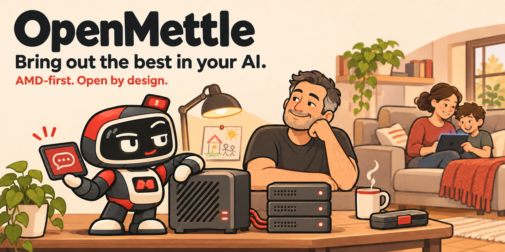

# OpenMettle

**Bring out the best in your AI. Private, multi-user self-hosted AI built in Rust and PostgreSQL 18.**

OpenMettle is an independent open-source platform born in a home lab and engineered clean-room for people and organisations who want to own their AI stack without sacrificing multi-user privacy, reliability, or hardware efficiency. It brings together a Rust API and run-worker core, PostgreSQL 18 persistence, Kubernetes/Helm packaging, curated AMD-first ROCm serving, a planned Flutter web and mobile app, and a local IDE coding agent.

**AMD-first. Open by design.** AMD GPUs and the ROCm ecosystem are the primary focus for serving optimisation and validation, while the core application runs on CPU alone and supports external compatible backends alongside planned NVIDIA device profiles.

## Editions & direction

OpenMettle starts from its open-source home-lab core and lays a single multi-user architectural foundation for three environments:

- **Home & Household (Open Source — In Active Build):** Private, approachable AI for home labs and families — shared local hardware without shared chat history, one-time home invitation codes and automatic family onboarding, and built-in quiet-hour and study-hour schedules.
- **Education (Planned Offering):** Tailored for schools, labs, and universities — curriculum-aligned study hours and model allowlists, OIDC/SSO directory group sync with fail-closed policy enforcement, strict per-student workspace isolation, and institutional data residency.
- **Small Business & Commercial (Planned Offering):** Private multi-user AI for teams — locked-down personal and project workspaces, human-in-the-loop tool approvals, quota and cost governance, retention and audit trails, and zero proprietary data sent to public AI clouds by default.

*Education and Small Business are planned offerings building on the open-source v1 core. No release dates or formal third-party compliance certifications are claimed.*

## Security, privacy & governance architecture

Self-hosting only stays private when isolation is enforced end to end across shared hardware:

- **Per-user chat lockdown & prefix-cache isolation:** Conversations, artifacts, and memory are private to their creator by default — even inside shared projects and against account administrators — until explicitly shared via revocable grants with `404` concealment (`ADR 0027`). OpenMettle's own inference proxy strips caller-supplied SGLang routing keys and injects a scoped cryptographic `cache_salt` so upstream KV prefix caches do not bleed across users or private chats on qualified backends (`ADR 0044`).
- **Four-point family & study protection rules:** Timezone- and DST-accurate quiet hours, study-hour model allowlists, and per-user or group model switches are evaluated by a single PostgreSQL policy function and enforced independently at API admission, worker step recheck, database round handoff, and proxy dispatch (`ADR 0044`, migration 35).
- **Least-privilege database & identity isolation:** Four disjoint non-DDL, non-`DELETE` PostgreSQL 18 runtime roles (`openmettle_api`, dedicated session-issuing `openmettle_issuance`, `openmettle_worker`, and `openmettle_gateway`), OIDC/SSO with local operator identity approval gates and home invitation codes (`ADR 0003`, `ADR 0022`, `ADR 0030`), plus single-use per-round inference bearers whose plaintext never touches PostgreSQL (`ADR 0044`).
- **Governance, approvals & verifiable auditability:** Human-in-the-loop tool approvals cryptographically bound (SHA-256) to canonical arguments, version, and destination with policy-gated opt-in YOLO (`ADR 0035`); exact-integer transactional quotas across tokens, cost micro-units, storage bytes, and device slots (`ADR 0040`); soft-delete grace windows, operator holds, an append-only SHA-256 hash-chained deletion journal and fail-closed restore barrier (`ADR 0041`); and default-deny, value-free structured telemetry with OTLP export off by default (`ADR 0024`, `ADR 0028`).

## Serving & platform engineering

- **Demand-driven Elastic KV Cache & AMD-first ROCm/RDNA4 serving:** Curated SGLang work (`OpenMettle/sglang`, `openmettle-serving`) combining HIP virtual-memory **Elastic KV Cache** (protecting active chats in a guaranteed base while lending spare VRAM to a reclaimable prefix-cache tail, then confirming multi-rank release for image, video, or tool workloads under fenced PostgreSQL capacity grants, `ADR 0042`), FP8 attention caching, MXFP4 quantization, and speculative decoding research.
- **Durable leased runs & conversation branching:** Server-owned background runs in PostgreSQL (`SKIP LOCKED` fair queuing, fenced leases, and crash recovery without replaying uncertain side effects) survive browser and mobile disconnects with HMAC-signed replayable SSE cursors (`ADR 0032`–`0034`), paired with non-destructive parent-linked conversation branch graphs and transparent context budgets (`ADR 0036`).

## Repositories

| Repository | Role | Current status |
| --- | --- | --- |
| [openmettle-core](https://github.com/OpenMettle/openmettle-core) | Accepted v1 architecture, ADRs 0001–0044, OpenAPI 3.2 contracts, Rust API, worker, migrator, and inference proxy | Active v1 development |
| [openmettle-deploy](https://github.com/OpenMettle/openmettle-deploy) | Generic Kubernetes/Helm packaging, deny-all NetworkPolicies, kind smoke checks, and optional GPU profiles | Core chart in progress |
| [openmettle-serving](https://github.com/OpenMettle/openmettle-serving) | Model-independent serving profiles, GPU kernel check tools, and qualification harnesses | Reference serving repo |
| [sglang](https://github.com/OpenMettle/sglang) | Maintained SGLang fork (`openmettle/rdna4`) with ROCm/RDNA4 fixes, FP8 KV cache, and Elastic KV Cache | Reference serving fork |
| [openmettle-app](https://github.com/OpenMettle/openmettle-app) | Flutter web and mobile presentation layer consuming core v1 APIs and replayable SSE | Step 2 · Bootstrap only |
| [openmettle-acp](https://github.com/OpenMettle/openmettle-acp) | Local IDE/CLI coding agent for JetBrains IDEs and compatible ACP clients | v0.7.0 · v1 adapter planned |
| [openmettle-public-site](https://github.com/OpenMettle/openmettle-public-site) | Zero-JS static public website | Published static site |

## Meet Mettle

Mettle is our capable, slightly cheeky digital sidekick. His graphite shell and red compute core reflect the hardware roots; the small keyhole in his status tab represents the project's privacy focus.

The [brand asset collection](https://github.com/OpenMettle/.github/tree/main/assets/brand) contains the current avatar and banners, mockups, earlier concepts and a guide for keeping the identity consistent.

## Project status

**Active v1 development.** OpenMettle v1 is a clean-room build governed by the accepted [v1 architecture baseline](https://github.com/OpenMettle/openmettle-core/blob/main/ARCHITECTURE-v1.md): step 1 delivers the Rust backend, PostgreSQL 18 schema, and versioned APIs; step 2 delivers the Flutter web and mobile client. There is no general OpenMettle installer, packaged gateway chart, or stable v1 release yet. Hardware support, live multi-user qualification, privacy controls, and performance measurements are documented with reproducible evidence as components qualify.

## Get involved

- Read the [v1 architecture baseline](https://github.com/OpenMettle/openmettle-core/blob/main/ARCHITECTURE-v1.md) and [decision records index (ADRs 0001–0044)](https://github.com/OpenMettle/openmettle-core/blob/main/DECISIONS.md).
- Read the [project brief](https://github.com/OpenMettle/.github/blob/main/docs/PROJECT-BRIEF.md) and [contribution guide](https://github.com/OpenMettle/.github/blob/main/CONTRIBUTING.md).
- Open an [issue](https://github.com/OpenMettle/.github/issues) for project-wide questions and proposals, or use the relevant component repository for a reproducible problem.
- Use the [repository starter](https://github.com/OpenMettle/repository-template) for new components.

OpenMettle is an independent community project. Results depend on the model, available hardware, configuration and task.
